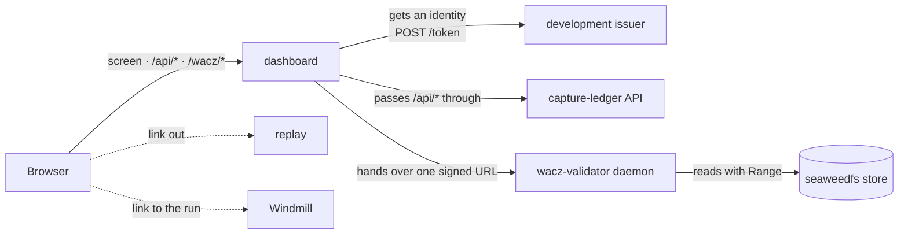

dashboard is the crawler's development screen. **It shows one crawl as one row.**

A crawl is started by [capture-ledger](https://github.com/uraitakahito/capture-ledger) (the ledger
that decides which URLs get captured and records what came back), run by
[capture-scheduler](https://github.com/uraitakahito/capture-scheduler) (which drives crawls with
Windmill flows), stored in [seaweedfs](https://github.com/uraitakahito/seaweedfs) (the
S3-compatible store the crawler shares) and opened with
[replay](https://github.com/uraitakahito/replay) (which plays a WACZ back in the browser). A WACZ
(Web Archive Collection Zipped) is the archive format that packs the captured pages into a single
ZIP.

In your head that is one crawl, but it used to be spread over four screens. dashboard assembles
one picture across those four from the ledger's API. From the same screen you can also check
whether a captured WACZ conforms to the spec, and look inside it. Those answers come from the
daemon of [wacz-validator](https://github.com/uraitakahito/wacz-validator) (the validator that
checks a WACZ rule by rule).

## Wiring

The browser only ever talks to dashboard (same origin). dashboard gets an identity token from the
development issuer and passes `/api/*` straight through to the ledger. For validating a WACZ and
reading its contents, it asks the ledger to sign a URL and hands that URL to the daemon, which
reads the archive itself. replay and Windmill are only linked to from the rows.

## Promises

- **It holds no secrets.** The token it presents to the ledger is fetched from the development
  issuer's `POST /token` every time it starts. `.env` only says who you look as and where to look;
  there is nowhere to put a key or a token.
- **So it is not a boundary.** The development issuer hands out a token for any name it is asked
  for. The identity here is a convenience, not a protection, and the screen says so in its
  header.
- **It has no dependencies.** The screen is built from the Node standard library and plain
  JavaScript that runs as-is in the browser. The only thing with dependencies is the source of
  this site (`docs-site/`).
- **It only relays.** No screen logic lives on the server. The moment it did, there would be a
  copy of what the ledger knows.
- **It owns no wording.** Validation messages, their Japanese text and the spec sections all come
  back from the daemon already resolved, and are shown as they are. If the screen rephrased them,
  it would quietly drift from what the validator has started to say.

## Not published

The screen binds to `127.0.0.1` only and is served over plain http. Chrome's Private Network
Access (PNA, which blocks requests from public pages to your local network) stops an https page
from calling `127.0.0.1`. So there is no way to put **the screen** on GitHub Pages. What lives on
Pages is this documentation only.

## Where to go next

- **[Quickstart](/quickstart/)** — bring the screen up, grant your identity access, fix things
  from the message you see.
- **[Screens](/screens/)** — what the four views show, how states are worded, how often it polls.
- **[Inspecting a WACZ](/wacz/)** — the two steps of validation, the report, the contents view.
- **[Configuration](/configuration/)** — the environment variables and the order they are read in.
- **[Routes](/routes/)** — what the server answers, which headers pass, what failures look like.
- **[Development](/development/)** — where the dependencies stop, what the tests do not see,
  editing these docs, releasing.
