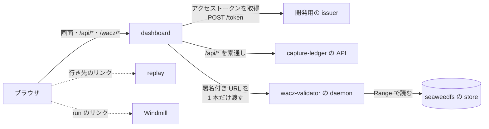

dashboard は crawler の開発用の Web アプリです。**1 本のクロールを 1 行で見ます。**

クロールを始めるのは [capture-ledger](https://github.com/uraitakahito/capture-ledger)（どの URL を撮るかを決め、撮れたものを記録する台帳）、
走らせるのは [capture-scheduler](https://github.com/uraitakahito/capture-scheduler)（クロールを Windmill の flow で回す）、
撮れたものを置くのは [seaweedfs](https://github.com/uraitakahito/seaweedfs)（crawler が共有する S3 互換の store）、
開いて読むのは [replay](https://github.com/uraitakahito/replay)（WACZ をブラウザで再生する画面）です。
WACZ（Web Archive Collection Zipped）は、撮ったページを 1 つの ZIP にまとめたアーカイブの形式です。

人の頭の中では 1 本のクロールなのに、画面は 4 枚に割れていました。
dashboard は、その 4 枚を跨いだ像を台帳の API から 1 枚に組み立てます。
撮れた WACZ が仕様どおりかと、その中身も、同じ dashboard から見られます。
答えるのは [wacz-validator](https://github.com/uraitakahito/wacz-validator)（WACZ を規則ごとに検証する検証器）の daemon です。

## 配線

ブラウザが話す相手は dashboard だけです（同一オリジン）。
dashboard は開発用の issuer からアクセストークンを取得し、それを付けて `/api/*` をそのまま台帳へ通します。
書くのは、新しいクロールの画面から始めるときの `POST /api/crawls` だけで、同じ道で台帳へ通します。
WACZ の検証と中身は、台帳に署名してもらった URL を daemon に渡して読ませます。
replay と Windmill へは、画面の行からリンクで飛ぶだけです。

## 約束

- **秘密を持たない。**
  台帳に示すアクセストークンは、開発用 issuer の `POST /token` から要るときに取得します。
  `.env` に書くのは「誰として見るか」と「どこを見るか」だけで、鍵にもトークンにも置き場がありません。
- **そのぶん、境界ではない。**
  開発用 issuer は、頼まれれば誰の名前でもトークンを出します。
  ここの名乗りは便利さであって守りではなく、dashboard もそう書いています（「開発用の名乗りです」）。
- **npm の依存を持たない。**
  dashboard は node の標準ライブラリと、ブラウザで素のまま走る JS、それにスクリプトに色を付ける commit 済みの 1 ファイル（`public/vendor/shiki.js`）で建っています。
  依存が在るのは、このサイトの原稿（`docs-site/`）と、その 1 ファイルを作る元（`highlighter/`）です（[開発](/development/)）。
- **中継するだけ。**
  dashboard のロジックはサーバに置きません。
  置いた瞬間に「台帳が知っていることの写し」が生まれるからです。
- **文を持たない。**
  検証の message も、日本語も、仕様の節も、daemon が解決して返したものをそのまま出します。
  dashboard が言い換えると、検証器が言い始めたことと静かにずれていきます。

## 公開しない

dashboard は `127.0.0.1` にだけ bind し、http で配ります。
https のページから `127.0.0.1` を叩くと、Chrome の Private Network Access（PNA。公開のページから手元のネットワークへの要求を止める仕組み）が止めます。
だから**dashboard を** GitHub Pages に置く道はありません。
Pages に置いてあるのは、この説明だけです。

## 次に読むもの

- **[クイックスタート](/quickstart/)** —— dashboard を起こす、名乗りに許可を付ける、出た文から直す。
- **[画面](/screens/)** —— 5 つの画面に何が並ぶか、状態の言い方、引く間隔。
- **[WACZ を見る](/wacz/)** —— 検証の 2 段と報告、中身の画面。
- **[設定](/configuration/)** —— 環境変数の表と、読む順。
- **[中継の口](/routes/)** —— サーバが答える口、通すヘッダ、失敗の形。
- **[開発](/development/)** —— 依存の線、試験が見ないもの、docs を直す、リリース。
