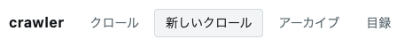
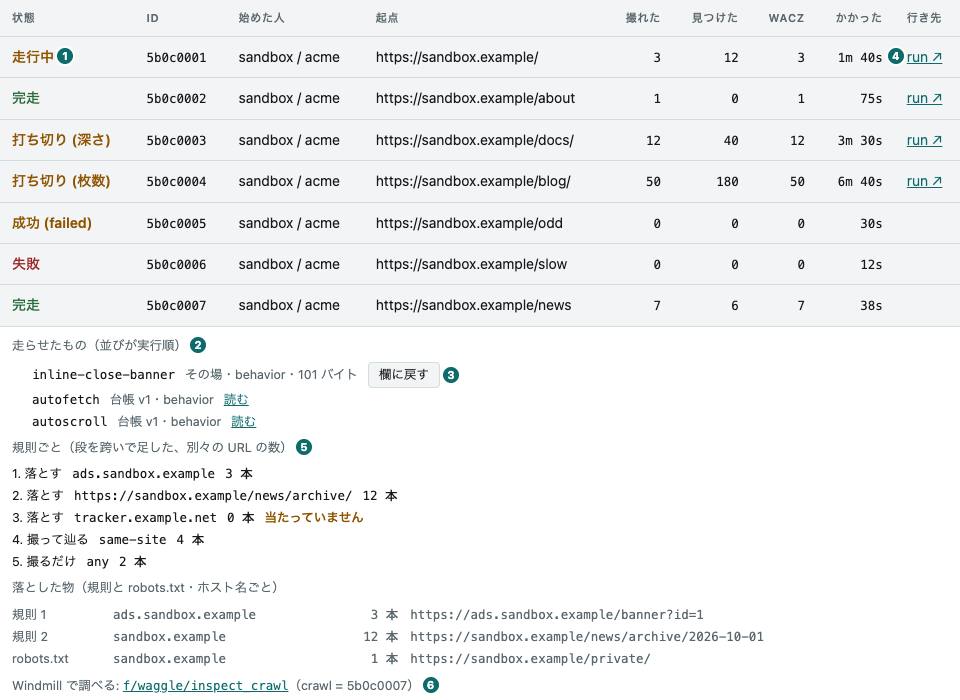
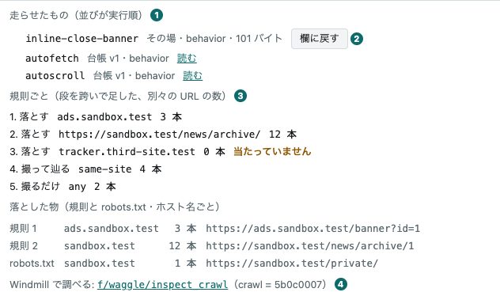
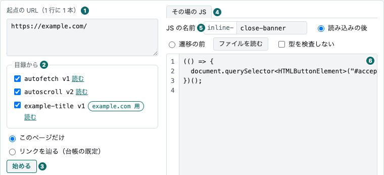
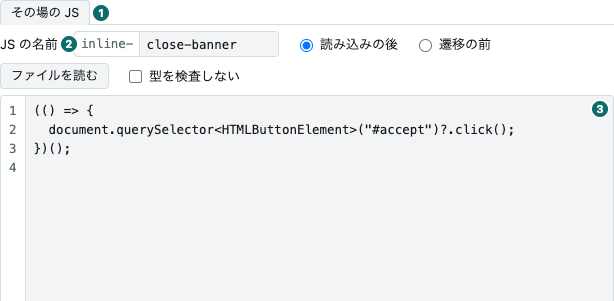
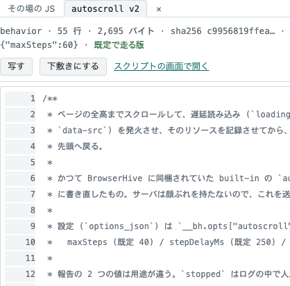
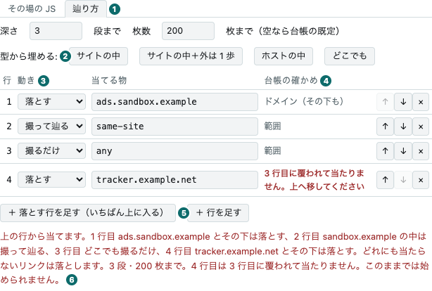
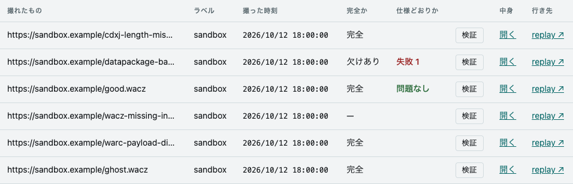
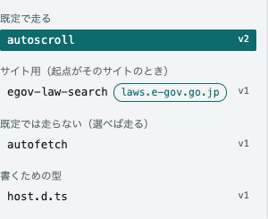
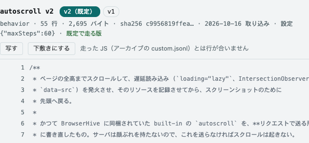

dashboard は 5 つの画面からなります。
上のタブで切り替え、URL の `#` が画面を決めます（`#crawls`・`#start`・`#archives`・`#scripts`。スクリプトの画面では、読んでいる物も URL が名指します）。
中身の画面のタブは、アーカイブの行の「開く」で入るまで出ません。

このページの絵は、代役（[サンドボックス](/development/#サンドボックスで開く)）を相手に撮っています。
代役のスクリプトは capture-scripts の写しで、本物の台帳と同じ物が並びます（autoscroll v2 だけは、版の札を見せるための代役の版です）。

| 画面 | 何が並ぶか |
| --- | --- |
| クロール | 1 行 = 1 本。状態・撮れた数・見つけた数・WACZ（撮ったページを 1 つの ZIP にまとめたアーカイブ）の数・かかった時間・run への行き先 |
| 新しいクロール | 起点の URL・スクリプト・深さを選び、その場の JS を書いて始める。JS の箱は窓の高さいっぱい。スクリプトは右の列のタブで読める |
| アーカイブ | 見えている WACZ。行から検証・中身・[replay](https://github.com/uraitakahito/replay)（WACZ をブラウザで再生する画面）へ |
| スクリプト | ページの中で走らせるスクリプトと、書くための型。行番号つきで読め、古い版も読める。空なら赤で言う |
| 中身 | WACZ 1 本の中。[WACZ を見る](/wacz/)に書いた |

画面の上には、誰として見ているかが出ます（「… として見ています —— 開発用の名乗りです」）。
足元には、いま並んでいる行の数と、次に引くまでの間隔が出ます。

## 並ぶのは台帳の 1 ページ

クロールとアーカイブは、台帳が返す最初の 1 ページ（新しい順）だけを並べます。
dashboard は続きを取りに行きません。
アーカイブは、そのページの中から名乗りが見てよいものだけが返るので、1 ページの数より少ないことがあります。
足元の「クロール N 本 ／ アーカイブ N 本」は並んでいる行の数で、台帳に在る全部の数ではありません。

## クロール

1 行が 1 本のクロールです。
状態・id の先頭 8 文字・始めた人と組織・最初の起点の URL・撮れた数・見つけた数・WACZ の数・かかった時間が並び、右端の「run ↗」が Windmill の run を新しいタブで開きます。

① 状態\
② run の行き先

- **撮れた数と見つけた数は、欄を分けてある。**
  見つけた数（`pagesDiscovered`）はリンクを辿って見つけた数なので、深さ 0 のクロールは「撮れた 1・見つけた 0」になります。
  1 つの欄に `1 / 0` と並べると、分母より分子が大きく見えてつまずきます。
- **かかった時間は、走行中なら「いままで」。**
  終わった時刻が無いのは「まだ終わっていない」であって、「時間が無い」ではありません。
- **run ↗ は、最後に投げた段の run。**
  行き先は、台帳が返す `lastJob` の id と、サーバが `/healthz` で配る Windmill の origin と workspace から組みます。
  台帳が `lastJob` を持たない行には出ません。

① 走らせたもの（並びが実行順）\
② 欄に戻す\
③ 規則ごとの数\
④ Windmill で調べる（inspect_crawl へのリンク）

- **行を押すと、失敗の文・走らせたもの・取れなかった URL が出る。**
  そのときだけ `/api/crawls/:id` を引きます。
  先頭は台帳の `error` で、文は言い換えません。
  compile の段で落ちたクロールは 1 枚も撮っていないので、取れなかったページが空になり、それだけでは成功のように読めるためです。
  次が走らせたもので、並びが実行順です。
  台帳のスクリプトは版と「読む」（押すと[スクリプト](#スクリプト)の画面で、そのクロールが走らせた版が開きます）を、その場で書いた物は「その場」と大きさ（バイト）を出し、その場の物には「欄に戻す」が付きます（押すと[新しいクロール](#新しいクロール)の画面へ移ります）。
  サイト用のスクリプトには札（`laws.e-gov.go.jp 用` のような印）が付きます。
  最後が取れなかったページで、並ぶのは台帳が返す分だけです。
  1 つも無ければ、そう言って起点の URL を並べます。
- **開いた行には、規則が何を決めたかも出る。**
  台帳の `/api/crawls/:id/decisions` を、詳しい所と一緒に引きます。
  まず規則ごとに、当たった別々の URL の数を段を跨いで足した物。1 度も当たらなかった規則には「当たっていません」と添えます。当たらない規則は、たいてい書いた人の意図と違うことを言っています。
  次に落とした物を、ホスト名ごとに。規則で落とした物・どの規則にも当たらなかった物・robots.txt のために取らなかったページです。
  リンクを 1 本も見ていないクロールは、全部の規則に 0 を並べず、そう 1 行で言います。
  最後が「Windmill で調べる」のリンクで、Windmill の `f/waggle/inspect_crawl` を、このクロールの id を入れた状態で開きます（Windmill は run の引数を URL の hash に持ちます）。
- **開いた行は、引き直しても閉じない。**
  表は引くたびに作り直すので、開いている行を id で覚えておき、最後の答えで開き直します。
  引き直すのは、走行中か、状態が変わった行だけです。

### 状態は stopReason と合わせて言う

`state` だけでは足りません。
`succeeded` には、全部を辿り終えた完走と、深さや枚数の上限で止めた打ち切りが混ざっています。
dashboard は `stopReason` と合わせて「完走」「打ち切り (深さ)」のように言い分け、知らない `stopReason` は括弧に入れてそのまま見せます。

言い分けの規則は `public/format.js` の `stateOf` で、`test/format.test.mjs` が固定しています。
ブラウザが読むのと同じファイルを試験も読むので、写しが腐りません。

## 新しいクロール

タブ「新しいクロール」の画面から、クロールを始めます。
左の列に起点の URL・スクリプト・深さと「始める」、右の列にその場の JS の箱と辿り方が並びます。
右の列はタブで、スクリプトを読む窓に切り替わり、「リンクを辿る」を選んでいる間は「辿り方」にも切り替わります。
箱は窓の高さいっぱいまで伸び、左に行番号が付きます。巨大な JS を貼って、読んで、少し直して始めるための形です。
起点の URL を 1 行に 1 本書き、「このページだけ」か「リンクを辿る」を選んで「始める」を押します。

① 起点の URL\
② スクリプト（チェックと「読む」）\
③ 始める

① 右の列のタブ\
② JS の名前\
③ JS の箱

- **送るのは、起点の URL と、深さ 0 かどうかと、走らせるもの（既定から変えたときだけ）。**
  「このページだけ」は `maxDepth: 0` を送ります。「リンクを辿る」は規則を送り、深さと枚数は書いたときだけ送ります（空なら台帳の既定）。
  起点で決まる既定の顔ぶれ（既定に入るスクリプトのうち、札の無い物と、起点に合うサイト用の物）を選んだままで、その場の JS も無ければ、`scripts` は送りません。台帳も起点から同じ物を選んで走らせます。
  台帳にスクリプトが無ければ今までどおり 400 で、スクリプトは在るのに起点に合う物が 1 つも無ければ、別の文の 400 です。
  そうでなければ `scripts` を送ります。その場の JS が先、選んだスクリプトが台帳の並びで後です。全部外せば `[]` で、何も走らせません。
  URL も JS の名前も dashboard では検査せず、台帳が 400 で言います（断った id を名指します）。
- **サイト用のスクリプトは、起点がそのサイトのときだけ選べる。**
  札のあるスクリプトは、起点のどれかが札のホストにあるときだけチェックを押せます。照らすのは起点のホスト名との完全一致で、ポートは見ません（`laws.e-gov.go.jp` と `www.e-gov.go.jp` は別のホスト）。
  起点を書くと、合うスクリプトには自動でチェックが付き、合わないスクリプトは押せなくなって「起点に laws.e-gov.go.jp がありません」のように理由が出ます。起点が空なら「起点を書くと選べます」です。
  見本は capture-scripts の `egov-law-search`（札 `laws.e-gov.go.jp`）で、[e-Gov 法令検索](https://laws.e-gov.go.jp/)の頁の中で法令名を「セキュリティ」で検索します。起点に `https://laws.e-gov.go.jp/` を書くと選べます（上の絵）。
  外したチェックは覚えていて、起点を書き換えても付け直しません。決まりは台帳と同じで、合わないスクリプトを名指して送れば、台帳が 400 で断ります。
- **既定では走らないスクリプトは、外れた状態で並ぶ。**
  名前の横に「既定では走らない」と出ます（上の絵では autofetch）。[capture-scripts](https://github.com/uraitakahito/capture-scripts) の `catalog.json` に `"default": false` と書いたスクリプトで、台帳はその全部の版を無効にして持ちます。何も名指さないクロールでは走りません。
  付ければ名指して送り、台帳はその最新版を走らせます。付けたチェックも外したチェックと同じく覚えていて、引き直しても戻しません。
- **送る前に、本文の大きさを見せる。**
  箱の下に、行数・送る本文の大きさ（UTF-8 のバイト）・上限に対する割合が出ます。
  上限は書く口と同じで、サーバが `/healthz` の `writeLimit` で配ります。超えると赤で言い、「始める」を押せなくなります。
- **JS の名前が、その JS の id になる。**
  右の列の「JS の名前」の欄に、その場の JS の名前を書きます。前の `inline-` は付いたままで、たとえば `close-banner` なら id は `inline-close-banner` です。
  綴りは英小文字で始め、英小文字・数字・`-` だけで、57 字までです（台帳の決まり）。dashboard は検査しません。違えば、名前が空でも、台帳が 400 で断り、左の列の下に `body/scripts/0/inline/name must match pattern "^[a-z][a-z0-9-]*$"` のような文が出ます。
  名前を送るのは、箱に JS があるときだけです。箱が空なら、名前は使いません。
  id は、クロールの行の「走らせたもの」と、アーカイブの `behaviors/custom.jsonl` に出ます。JS の中で報告するときの鍵も、この id です（`__bh.report("inline-close-banner", …)`）。「欄に戻す」も、この名前で JS を取り戻します。
- **その場の JS は、strict の TypeScript として型を検査されます。**
  最初の段の compile で検査され、1 つでも誤りがあればクロールごと落ちます。診断は件数と最初の 5 件が、行を開くと読めます。
  IIFE で包み、取り出す要素には型を付けて `?.` で扱ってください。`export` は書かないでください。ページで構文エラーになり、何も走りません。
- **束ねた JS は「型を検査しない」で。**
  チェックを入れると箱の 1 行目に `// @ts-nocheck` が入り、外すと消えます。見えている物が送る物で、台帳が打つ sha256 にも入ります。
  貼った JS が 1 行目に印を持っていれば、チェックは付いた状態になります。
- **箱は折り返さない。**
  行番号とずれないように、長い行は横に流します。
  「読み込みの後」は主フレームで 1 回、「遷移の前」は全部のフレームで遷移のたびに走り、受け皿（`__bh`）がありません。
  「ファイルを読む」は、別の所で書いたファイルを箱に読み込みます（ブラウザの中だけで読みます）。JS の名前の欄が空なら、拡張子を除いたファイル名が入ります。綴りが決まりに合わなければ（大文字や `_`）、直してから始めてください。
- **スクリプトは、右の列で読める。**
  チェックの横の「読む」を押すと、右の列に 2 つ目のタブ（`autoscroll v2` のような名前）が開き、そのチェックの版の source が色つきで出ます。画面は移りません。
  JS の箱は隠れるだけで、書きかけも流した位置も残り、タブ「その場の JS」で戻ります。読みながらチェックを付け外しできます。押せないサイト用のスクリプトの横の「読む」も押せます。
  開いておけるのは 1 つで、別の「読む」で入れ替わり、× で閉じます。窓には「写す」「下敷きにする」と、スクリプトの画面で開くリンクがあります（版の札と行の URL は[スクリプト](#スクリプト)の画面にだけ在ります）。
  ⌘ や Ctrl を押しながら押すと、ブラウザがスクリプトの画面を別のタブで開きます。

- **202 と 409 は、クロールの画面へ移る。**
  受理されたら始めた行に、走行中のクロールがあれば塞いでいる行に印が付きます（台帳は全体で 1 本しか走らせません）。
  受理されたので、足元は 2 秒ごとに引くようになります。
  それ以外（400・413・届かない）はこの画面に残り、左の列の下に台帳の文をそのまま出します。
- **202 の後、起点の URL は消え、その場の JS は残る。**
  直して撮り直すことが多いからです。
- **「欄に戻す」で、この画面に戻る。**
  クロールの画面で行を開き、その場の JS の「欄に戻す」を押すと、この画面へ移り、名前・口・JS が戻ります。
  JS は台帳の `/api/crawls/:id/inline/:name` から取ります（行の詳しい所には大きさしか載りません）。起点とスクリプトの選びは触りません。
  右の列で読んでいても、タブ「その場の JS」に替わります。
- **[スクリプト](#スクリプト)の画面の「下敷きにする」で、スクリプトがこの画面に来る。**
  名前の欄が空なら `my-<id>` が入ります。替えるのは、そのスクリプト自身の id を名指す 2 つの形 —— `__bh.opts["<id>"]` と `__bh.report("<id>"` —— だけで、`inline-<名前>` にします。替えた行は左の列の下に出ます。
  元のスクリプトのチェックは外します（両方走ると 2 回走ります）。箱に書きかけがあれば、スクリプトの画面で置き換えるかを訊きます。
  右の列の読む窓の「下敷きにする」も同じです（確認は読む窓の中で訊きます）。写した後はタブ「その場の JS」に替わり、読む窓は開いたままなので、元と見比べられます。
  サイト用のスクリプトを下敷きにしても、札は写しに付きません。その場の JS はどの起点でも走るので、スクリプトの冒頭の見分け（`location.hostname` を比べる行）が、ほかのサイトでは何もさせません。
- **受け皿（`__bh`）の型は、注意書きのリンクから読める。**
  左の列の下の注意書きに、型へのリンク（`#scripts/types/host.d.ts`）があります。ふつうに押すと、右の列の読む窓に開きます。
- **「リンクを辿る」を選ぶと、「辿り方」のタブが開く。**
  深さと枚数・型・規則の表が並びます。規則は「動き」と「当てる物」の組です。
  動きは「撮って辿る」「撮るだけ」「落とす」、当てる物は `same-origin`・`same-host`・`same-site`・`any`（起点と比べる）、小文字のホスト名（そのホストとその下のサブドメイン）、`http(s)` の URL（前方一致）のどれかです。
  台帳は上から当て、最初に当たった規則が決め、どれにも当たらないリンクは落とします。
  タブは「ホストの中」で始まります。型「サイトの中」「サイトの中＋外は 1 歩」「ホストの中」「どこでも」は、どれも「撮って辿る」を 1 本持ちます。起点が撮って辿るに当たらないと、台帳が断るからです。
  「＋ 落とす行を足す」は、いちばん上に足します。広い「撮って辿る」の下に置くと、覆われて二度と当たりません。
  ↑ ↓ × は行の番号を読み上げ、動かした行に focus が付いて行きます。

① 辿り方\
② 型\
③ 規則ごとの動き\
④ 台帳の確かめ（行ごと）\
⑤ 落とす行を上に足す\
⑥ 何を辿るかの言い直し

- **書いている間に、台帳が規則を確かめる。**
  手が 300 ms 止まると、台帳の `GET /api/crawl-rules/check` を引きます（何も書かない口なので、一覧と同じ素通しに乗ります）。
  行ごとに、台帳が読んだ種類（範囲・ドメイン・前方一致）か、赤い字で「読めません」「n 行目に覆われて当たりません」が出ます。
  表の下の文は、何を辿るかを台帳の読んだ形で言い直します（URL の前方一致は正規化した形で出ます）。
  台帳が「始められない」と言っている間は「始める」を押せません。台帳に確かめられないときは止めません —— 始めれば台帳が答えで言います。
- **始めた行は開かずに、印を付ける。**
  印は id で覚えておき、描き直しのたびに付け直します。

送る道は、[中継の口](/routes/)の `POST /api/crawls` です。

## アーカイブ

見えている WACZ が、撮った時刻の新しい順に並びます。

- **「完全か」の `—` は「分からない」。**
  台帳の `waczComplete` が null の行で、「欠けあり」とは別です。
- **「検証」は、押したときだけ走る。**
  一覧を開くだけでは走りません。
  結果は行の「仕様どおりか」にも残るので、何本か見た後でも、押し直さずに思い出せます。
  報告に何が出るかは [WACZ を見る](/wacz/)に書きました。
- **「開く」で中身の画面に入る**（`#wacz/<archiveId>`）。
- **「replay ↗」は replay で開く。**
  行き先は、サーバが `/healthz` で配る replay の origin と、台帳が返す `objectKey` から組みます。

## スクリプト

撮るページの中で走らせるスクリプトを、書いたままの形で読む画面です。自分のスクリプトを書く前の手本に、あるいはクロールが何を走らせたかを確かめるために。
左に一覧が 4 つの組で並びます。既定で走るもの（札の無いスクリプトの、有効な各 id の最新版。何も名指さないクロールが走らせる物）、サイト用のスクリプト（札のある物。起点がそのサイトのときだけ走る）、既定では走らないもの（有効な版の無いスクリプト。名指せば最新版が走る）、「書くための型」の `host.d.ts` —— 撮影のサーバがページに置く受け皿 `__bh` の型です。
型のほかは、[新しいクロール](#新しいクロール)の画面の「スクリプト」にもチェックとして並びます（既定では走らないものは外れた状態で）。
チェックの横の「読む」で、その画面の右の列でも読めます。

右には TypeScript が行番号つきで出ます。

| URL | 開くもの |
| --- | --- |
| `#scripts` | 一覧の頭（URL はそれを名指す形に替わる） |
| `#scripts/autoscroll` | いま既定で走る版（既定では走らないスクリプトは最新版） |
| `#scripts/autoscroll@1` | 版 1（有効でも無効でも） |
| `#scripts/autoscroll@1:33` | 版 1 の 33 行に印を付け、窓の真ん中に出す |
| `#scripts/types/host.d.ts` | 受け皿 `__bh` の型 |

- **見出しが、読んでいる版を言う。**
  版の札にその id の版が全部並び、既定の版には「既定」、無効な版には「無効」が付きます。
  その下に、行数・大きさ・sha256 の先頭・取り込んだ日・渡す設定（`{}` はコードに書いた既定のまま）・既定で走る版かどうかが出ます。
  サイト用のスクリプトなら名前の横に札が付き、既定の版は「起点に laws.e-gov.go.jp があれば既定で走る版」と言います。無効な版は「無効（既定では走らない）」です。
- **札は、決まったサイトの頁でだけ意味のあるスクリプトの印。**
  札（`sites`）はホスト名の列で、[capture-scripts](https://github.com/uraitakahito/capture-scripts) の `catalog.json` に書き、台帳が版ごとに持ちます。
  札のあるスクリプトは、クロールの起点のどれかがそのホストにあるときだけ既定で走ります。
  決まりはクロールの単位なので、リンクを辿って別のホストへ出た頁でも走ります。スクリプトは冒頭でホスト名を見て、ほかの頁では何もせずに終わります。
- **行を押すと、その行が URL になる。**
  人にそのまま渡せます。ブラウザの履歴は増えず、画面も描き直しません。
- **「写す」で source をクリップボードへ。**
  「下敷きにする」は、[新しいクロール](#新しいクロール)の画面へ、その場の JS として持って行きます。
- **source に色が付く。**
  色付けは [Shiki](https://shiki.style)（VS Code と同じ TypeScript の文法）で、配色は画面の明暗に合わせて GitHub Light High Contrast か GitHub Dark Default です（画面の地の上で、どの色も読める濃さを保つ組）。
  行は先に 1 色で出て、色は少し後から来ます。色付けは画面を描く thread の外（worker）で走るので、長いファイルでもすぐに読めて、流せます。
  印を付けた行は 1 色のままです。色を読み込めないときは本文の上の 1 行で言い、本文は 1 色のまま読めます。
- **行は TypeScript の行です。**
  クロールが走らせるのは変換後の JavaScript で、アーカイブの `behaviors/custom.jsonl` に残るのもそちらです。行は所々で数行ずれます。
- **クロールの「読む」は、そのクロールが走らせた版を開く。**
  sha256 の先頭も一緒に運びます。版の番号は使い回されることがある（最新の版を消して足し直すと、同じ番号が別の中身になる）ので、中身が違えば本文の上で言います。
- **取るのは、開いたものだけ。**
  一覧はいつもの引き直しの答えから作り、変わったときだけ描き直します。版の並びと中身は開いたときに、受け皿の型は画面を最初に開いたとき 1 回だけ取ります。
  読む口は capture-ledger の `GET /api/scripts/:id/versions`・`GET /api/scripts/:id/versions/:version`・`GET /api/host-types`（v0.60.0 から。札は v0.61.0 から。一覧の `GET /api/scripts` に既定では走らないスクリプトが `enabled: false` で載るのは v0.64.0 から）で、[中継の口](/routes/)を素通しで通ります。

**台帳にスクリプトが無ければ、赤で言います。**
撮影のサーバ（BrowserHive）は走らせるものを自分では持たないので、台帳にスクリプトが無いと、ページの中で何も走りません。
スクロールも遅延読み込みも起きないまま、それでも取り込みは成功し、アーカイブも出ます。
赤い文の中に、[capture-ledger](https://github.com/uraitakahito/capture-ledger)（クロールを始め、撮れたものを記録する台帳）で取り込むコマンドが出ます。

## 引く間隔

走行中のクロールが 1 本でもあれば 2 秒ごと、無ければ 30 秒ごとに、一覧を引き直します。
写しを持たなくても、走っている間は live に見えます。
動いていないときは黙ります。

取りに行けなかったときは、最後に描けた表を残したまま、画面の上に理由を出します（[クイックスタート](/quickstart/)の「出た文から直す」）。
