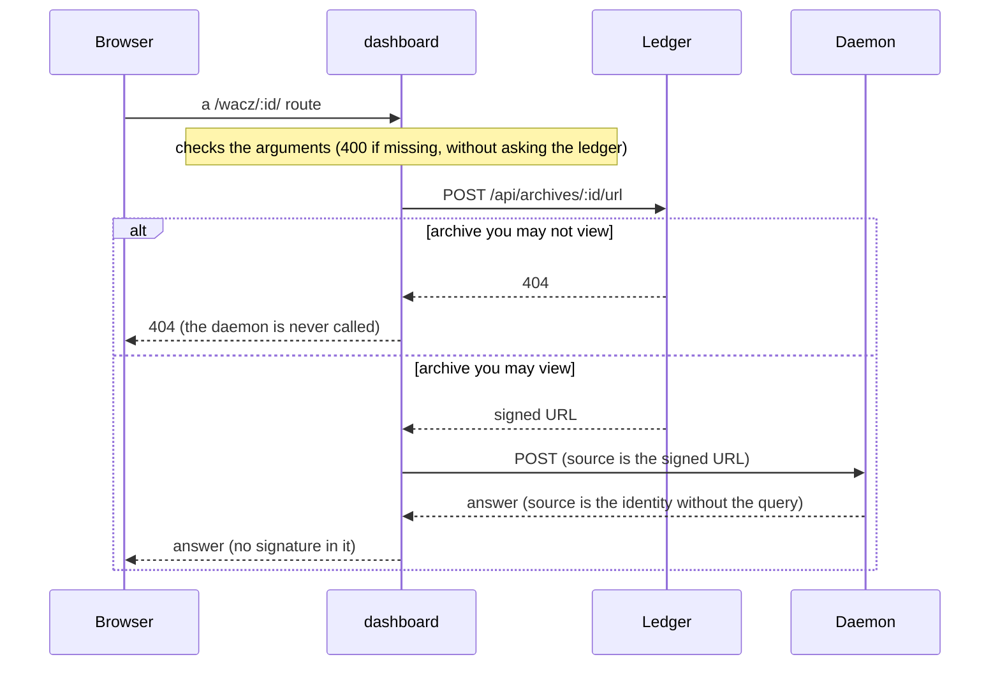

An archive row offers two things. 検証 (validate) checks whether the capture conforms to the WACZ
spec (WACZ is the archive format that packs captured pages into one ZIP), and 開く (open) takes
you inside the WACZ. Both are answered by the daemon of
[wacz-validator](https://github.com/uraitakahito/wacz-validator) (the validator that checks a
WACZ rule by rule). dashboard only hands the daemon a URL that the ledger has signed.

## Ask the ledger first

Every route takes the same two steps: get a signature from the ledger, then hand that URL to
the daemon (the routes are listed in [Routes](/routes/)).

- **No key is added anywhere.** What is handed over is one URL signed by the ledger; the daemon
  holds no credentials for the store.
- **The order matters.** Because the ledger is asked first, an archive you may not view ends in a
  404 and never reaches the daemon. The narrowing is done by the side that owns authorization.
- **The signed URL never leaves this server.** It is not in the response, not in the logs and not
  in an error message (if the daemon throws an error containing the URL, it is masked as
  `(署名付き URL)`). Exposing it would undo what authorization closed: until it expires, anyone
  holding the URL can read the archive. The `source` in the report is the identity the daemon
  derived by dropping the query, so it is safe to return.
- **The signature is fetched again for every call.** Keeping it would mean this screen holds a
  valid key for as long as it lives.

## The validation report

Pressing 検証 on an archive row opens that archive's report under the row.

- The number of passed rules, and the verdict (failures, warnings, or no problems). The screen
  never shows only the passes, because 0 warnings and 3 warnings are different states, and both
  have 0 failures.
- Which build of the validator looked at it and with which profile (`wacz-validator <version>` /
  `profile <name>`), and how long it took. The count of WARC records (WARC is the file that records the captured
  requests and responses in order) and the hosts appear only when the
  report has statistics (they are best-effort and can be missing for a broken WACZ).
- One finding per rule: severity, rule name, message, and a link to the spec (仕様 ↗).
- The entries of the ZIP. An entry that should be there but is not is marked 無い (missing).

The verdict also stays in the row's 仕様どおりか (conforms?) cell.

**The screen owns no wording.** Messages, their Japanese text and the spec links all come back
from the daemon already resolved, and are shown as they are. If the screen rephrased a rule, it
would quietly drift from what the validator has started to say. All the screen sends is
`locale`.

### It validates with the spec profile

The screen does not send a profile, so the daemon validates with its default, `spec`. Rules
that only apply to the capture server (BrowserHive) do not show up here. The report line says
`profile spec`, so you can see which profile was used. Validating against BrowserHive's own
profile would need a way for the screen to send a profile, which does not exist yet.

### The daemon does not rebuild itself

Releasing wacz-validator does not change the daemon that is running: it keeps running the build
it was started with. If it is out of date, the version in the report shows it.
`pnpm run dev:status` in [capture-ledger](https://github.com/uraitakahito/capture-ledger) (the
ledger that starts crawls and records what came back) also compares the running build with the
checkout. To restart it, run `pnpm run dev:up --from validator` in capture-ledger.

## The contents view

開く on an archive row enters the view for that archive. The URL is `#wacz/<archiveId>`, and
the selected entry and line are part of it too, so you can point at
`#wacz/<archiveId>/indexes%2Findex.cdxj:66`.

Opening it runs a validation, and the tree on the left is built from the report's entries. It
uses the same input and the same box-drawing lines as wacz-validator's terminal UI (waxlens). On
the right are the details of the selected entry (size, STORE or DEFLATE, which part of the spec
asks for it, the findings on that entry) and its contents.

- **Lines**: a window of 200 lines at a time. Long lines are cut horizontally. If there is more,
  a button reads the next window.
- **One line**: click a line to read all of it (a line that is too long is cut by the daemon, and
  the screen says it was cut at 4 MiB). CDXJ (the index format for WARC) and JSONL (one JSON per
  line) lines come back split into fields by the daemon; the screen does not know how to split them. For an index line, a button opens the
  record it points to.
- **Record list**: this is what you get for a `.warc.gz`. One row per record, walking the WARC
  from the start, 200 at a time, filterable by type. ▪ marks a record the index (CDXJ) points
  to, ▫ one the index does not. The records BrowserHive leaves for what it did not or could not
  capture (`WARC-Type: metadata`) are only visible here.
- **One record**: the WARC headers, the HTTP status line and headers, and the body. The body is
  shown as text, as a raster image, or as its size only.

Selecting an entry or a line inside the view only rewrites the URL; it does not validate again.
Only opening a different archive validates again and rebuilds the tree.

## Captured content was written by someone else

What is inside a WACZ was written by the authors of the captured pages. The screen inserts text
with `textContent` and shows images only as raster images in ``. The daemon marks images
with `nosniff` and `sandbox`, and refuses SVG and HTML with 415. The screen has no API that
inserts raw HTML, and `npm run check` makes sure there is no `innerHTML` in the JavaScript under
`public/`.
